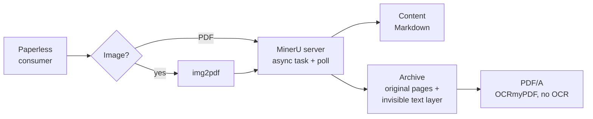

# paperless-mineru

A [Paperless-ngx](https://github.com/paperless-ngx/paperless-ngx) **parser plugin** that sends OCR and
document parsing to a **self-hosted [MinerU](https://github.com/opendatalab/MinerU) server** in place of
Tesseract. It writes a **searchable archive PDF with an invisible text layer**, so search, highlighting
and the archive version keep working in Paperless.

- Paperless still handles ingestion, thumbnails, dates, classification and storage. MinerU only does the
  OCR/layout work.
- Archive PDFs get an invisible text layer placed with MinerU's own bounding boxes (line-level on MinerU
  2.x/3.x). By default they are then converted to PDF/A following `PAPERLESS_OCR_OUTPUT_TYPE`, using
  OCRmyPDF with `ocr_engine=none`, so Tesseract never runs.
- Document content is MinerU's Markdown (headings, tables as text) or plain text.
- Supports **MinerU 2.x/3.x** (`/tasks`, `/file_parse`) and **MinerU ≥ 4.0** (`/v1/tasks`), detected
  automatically. Documents are submitted asynchronously and polled, so long documents and vLLM cold
  starts don't hit HTTP timeouts.
- Configured only through `PAPERLESS_MINERU_*` environment variables. Paperless core is not forked or
  patched.

> [!NOTE]
> Requires **Paperless-ngx 3.0 or later**, which introduced the `paperless_ngx.parsers` entry point. On
> 2.x the plugin is ignored. It also requires a running MinerU API server that the Paperless container
> can reach.

## How it works



The parser registers with score `20`, which beats the built-in Tesseract parser (`10`). It declares
`uses_remote_service = True`, so Paperless' [`PAPERLESS_REMOTE_OCR_MODE`](https://docs.paperless-ngx.com/configuration/#PAPERLESS_REMOTE_OCR_MODE)
applies:

- `always` (default): every PDF/image goes to MinerU.
- `workflow_only`: only documents matched by a workflow with the **Remote OCR** action go to MinerU.
  Everything else stays on Tesseract.

If `PAPERLESS_MINERU_ENDPOINT` is unset, the parser steps aside and Tesseract handles everything as
before. If MinerU fails or times out, consumption fails with a clear error. It doesn't silently fall
back to Tesseract.

## Installation

### A. Custom Docker image (recommended)

Build Paperless with the plugin baked in. You can build straight from GitHub:

```bash
docker build -f docker/Dockerfile --build-arg PAPERLESS_TAG=3.3.1 \
  -t paperless-ngx-mineru:3.3.1 \
  "https://github.com/Pacman1984/paperless-ngx-mineru-plugin.git#main"
```

Or from a local checkout:

```bash
docker build -f docker/Dockerfile --build-arg PAPERLESS_TAG=3.3.1 -t paperless-ngx-mineru:3.3.1 .
```

Then use `paperless-ngx-mineru:3.3.1` as the image of your Paperless service. See
[`examples/docker-compose.override.yml`](examples/docker-compose.override.yml) (option A). The plugin is
installed with `--no-deps`, because everything it needs (httpx, pikepdf, img2pdf, Pillow, OCRmyPDF)
already ships with Paperless.

### B. Bootstrap script (stock image)

Copy [`docker/custom-cont-init.d/`](docker/custom-cont-init.d) next to your compose file and mount it
to `/custom-cont-init.d`. The script installs at container start, either from a wheel placed in that
folder or from `PAPERLESS_MINERU_PIP_SPEC`, for example
`git+https://github.com/Pacman1984/paperless-ngx-mineru-plugin.git@main`. See option B in
[`examples/docker-compose.override.yml`](examples/docker-compose.override.yml).

To build a wheel:

```bash
uv build --wheel     # → dist/paperless_mineru-<version>-py3-none-any.whl
```

### C. Bare-metal Paperless

Install into the Python environment Paperless runs in:

```bash
uv pip install --python /path/to/paperless/venv/bin/python --no-deps \
  "git+https://github.com/Pacman1984/paperless-ngx-mineru-plugin.git@main"
```

## Configuration

Add the variables to `docker-compose.env`. Only `PAPERLESS_MINERU_ENDPOINT` is required. A commented
template is in [`examples/docker-compose.env.example`](examples/docker-compose.env.example).

| Variable | Default | Meaning |
| --- | --- | --- |
| `PAPERLESS_MINERU_ENDPOINT` | – | MinerU API base URL, e.g. `http://mineru:8000`. Unset → plugin inactive |
| `PAPERLESS_MINERU_API_KEY` | – | Sent as `Authorization: Bearer …` (MinerU ≥ 4 with `--api-key`) |
| `PAPERLESS_MINERU_API` | `auto` | `auto`, `legacy` (2.x/3.x) or `v1` (≥ 4.0) |
| `PAPERLESS_MINERU_BACKEND` | server default | 2.x/3.x: `pipeline`, `hybrid-engine`, `vlm-engine`, … |
| `PAPERLESS_MINERU_EFFORT` | server default | 2.x/3.x hybrid: `medium` or `high` |
| `PAPERLESS_MINERU_LANG` | from `PAPERLESS_OCR_LANGUAGE` | 2.x/3.x pipeline OCR language (`ch` also covers EN and Latin scripts such as German) |
| `PAPERLESS_MINERU_FORMULA_ENABLE` / `_TABLE_ENABLE` | `true` | 2.x/3.x formula/table recognition |
| `PAPERLESS_MINERU_TIER` | server default | ≥ 4.0: `flash`, `basic`, `standard`, `advanced` |
| `PAPERLESS_MINERU_OCR_MODE` | `auto` | `auto`, `txt` or `ocr` (`parse_method` on 2.x/3.x) |
| `PAPERLESS_MINERU_TIMEOUT` | `900` | Seconds per document (upload, queue and parse) |
| `PAPERLESS_MINERU_CONNECT_TIMEOUT` | `10` | TCP connect timeout |
| `PAPERLESS_MINERU_POLL_INTERVAL` | `2` | Seconds between status polls |
| `PAPERLESS_MINERU_CONTENT_FORMAT` | `markdown` | `markdown` (MinerU's Markdown, images removed, tables as text) or `text` |
| `PAPERLESS_MINERU_TEXT_LAYER` | `true` | Write the invisible text layer and produce an archive PDF |
| `PAPERLESS_MINERU_PDFA` | `true` | Convert the archive to PDF/A when `PAPERLESS_OCR_OUTPUT_TYPE` is `pdfa*` |
| `PAPERLESS_MINERU_SCORE` | `20` | Parser priority; must be > 10 to replace Tesseract |
| `PAPERLESS_MINERU_VERIFY_SSL` | `true` | TLS certificate verification |

These Paperless settings keep their usual meaning:

- `PAPERLESS_ARCHIVE_FILE_GENERATION` decides whether an archive is wanted. With `auto`, born-digital
  PDFs are not sent to MinerU.
- `PAPERLESS_OCR_OUTPUT_TYPE` sets PDF/A or plain PDF.
- `PAPERLESS_OCR_IMAGE_DPI` is the fallback DPI for images without DPI metadata.
- `PAPERLESS_REMOTE_OCR_MODE`: see above.

Supported input types are PDF, PNG, JPEG, TIFF, BMP, GIF and WebP. Office files keep going through
Tika/Gotenberg.

## Verify the installation

1. Restart Paperless and check the log (`docker compose logs webserver`). Discovery is logged as:

   ```
   Loaded third-party parser 'Paperless-ngx MinerU Parser' v0.1.0 by paperless-mineru contributors (entrypoint: 'mineru').
   ```

2. Consume a scanned PDF. The log shows:

   ```
   Document handled by third-party parser 'Paperless-ngx MinerU Parser' v0.1.0 — https://github.com/...
   MinerU (legacy API, v3.4.0) parsed scan.pdf
   ```

   On the MinerU side, `GET /health` shows `completed_tasks` going up.

3. In the Paperless UI, the document content is MinerU's text. If you search for a word, the archive
   PDF highlights it at the right spot.

If the discovery line is missing, the package isn't installed in Paperless' Python. Check with:

```bash
docker compose exec webserver python3 -c "import paperless_mineru; print(paperless_mineru.__version__)"
```

If the plugin loads but Tesseract still runs, check that `PAPERLESS_MINERU_ENDPOINT` is set and that
`PAPERLESS_REMOTE_OCR_MODE` is not `workflow_only`, or that it is but a workflow with the Remote OCR
action matches the document.

## Limitations

- **Text placement precision.** MinerU 2.x/3.x returns line-level boxes, so search highlights land on
  the exact line. MinerU ≥ 4.0 returns block-level boxes only. There the text is wrapped evenly inside
  each block, so search works but highlights are approximate.
- **Mixed PDFs.** Pages that already have a text layer (20+ characters) are not overlaid again, which
  avoids duplicate hits. MinerU still parses the whole document for the content.
- **OCR modes.** Paperless' `PAPERLESS_OCR_MODE` (`skip`/`redo`/`force`) and deskew/rotate/clean
  settings only apply to Tesseract. MinerU handles orientation itself, and the archive keeps the
  original pages.
- **Data leaves the Paperless host.** Documents go to your MinerU server, so keep it on a trusted
  network and use HTTPS or an API key when it isn't on localhost or a LAN you control.

## Development

```bash
uv sync                  # creates .venv with dev tools
uv run pytest            # unit tests (mocked MinerU, stubbed Paperless)
uv run ruff check .
```

End-to-end test against a real MinerU server, using Paperless 3.3.1 in Docker with SQLite and Redis.
It is a throwaway stack that is torn down afterwards:

```bash
cp tests/e2e/.env.example tests/e2e/.env   # set PAPERLESS_MINERU_ENDPOINT
bash tests/e2e/run-e2e.sh
```

## License

MIT
